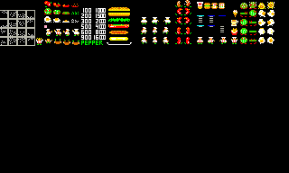
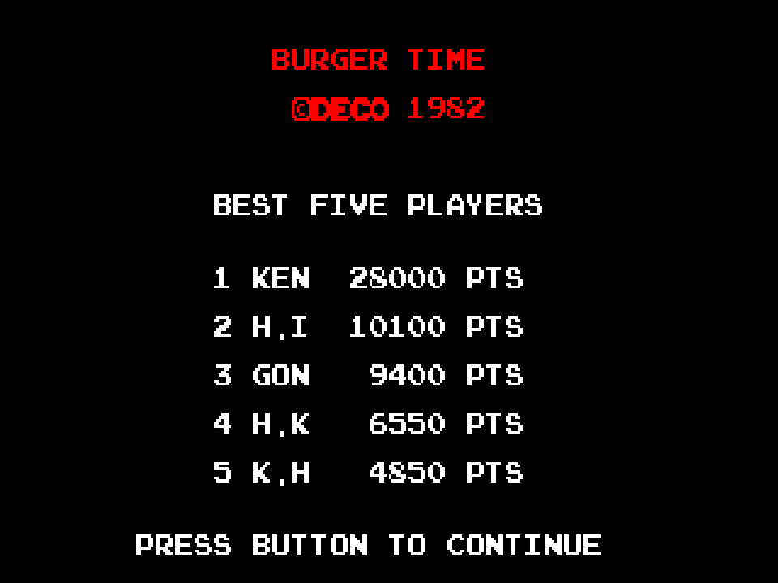
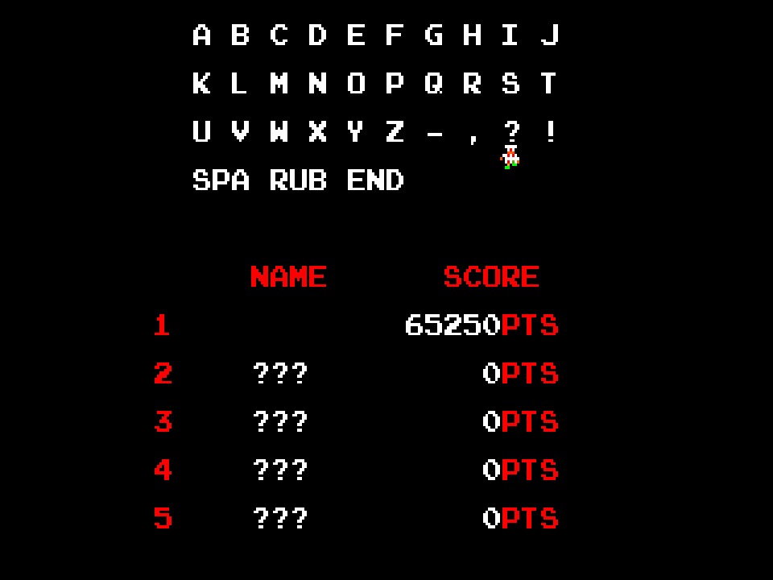

# BASIC Burger Time (`BURGER.BAS` / `TIME.BAS`)

A BurgerTime inspired game written in Extended Color BASIC for the Tandy Color Computer 3, by **CoCo-Synthesis**. Six stages recreated from the arcade original, falling ingredients, hungry enemies, pepper, music, saved high scores... and a Stage Manager so you can build a kitchen of your own!

## After BASIC Pac-Man...

The positive reception of [BASIC Pac-Man](https://github.com/CoCo-Synthesis/BASIC-Pac-Man) left me wanting to try another arcade classic using only Extended Color BASIC. BurgerTime seemed like a good follow-up. Walk around some platforms, climb a few ladders, drop some hamburger ingredients. How hard could it be?

It didn't take long before it looked like I had bitten off more than I could chew.

Pac-Man had its challenges, but BurgerTime needed ingredients that bend as you walk over them, drop onto other ingredients, carry enemies along for the ride, and set off chain reactions. Then there were the collisions, the squishing, the animation, and the small matter of putting the background back where it belonged afterward. All while BASIC was reminding me that memory is a very finite resource!

The project ended up with **156 distinct HBUFF graphics buffers defined across the launcher, game, score entry, and editor**. Those aren't 156 different characters; the count includes tiles, animation frames, ingredient pieces, score graphics, background storage, and editor buffers. Different program paths allocate the buffers they need. Still... that's a lot of HBUFFs!

There were plenty of moments when one more feature seemed like it might be the feature that wouldn't fit. But after a lot of rearranging, trimming, and testing, it all came together.

## From 16 x 16 to 8 x 8

The graphics in `BRGTILES.BIN` started in **MS Paint**. I hand drew the arcade's 16 x 16 sprites as 8 x 8 equivalents, trying to keep the Chef, Hot Dogs, Pickles, Eggs, and food recognizable with only a quarter of the pixels to work with.



*The working graphics sheet. The small tiles become the game's characters, scenery, food, and animation pieces.*

The game uses the CoCo 3's built-in high-resolution graphics commands, including `HGET` and `HPUT`, to capture and draw those pieces. A whole ingredient is wider than one tile, and its separate pieces let it react to the Chef's footsteps before it drops. There are also different images for enemies walking, being peppered, riding ingredients, and getting squished. Making a tiny character look right was only the beginning; making all of those images cooperate was the real project.

## Game Features

### Six original arcade stages

All six included stage layouts are replicas of the original arcade stages, adapted to the smaller tiles. The platforms, ladders, burger columns, and plates recreate those familiar kitchens instead of just borrowing the general idea.

Stages live in separate `STAGE n.DAT` files. The game loads them in numerical order and returns to Stage 1 when the next stage file is missing. Custom stages can extend the sequence without changing the game program; keep the stage numbers consecutive.

<!-- Fresh gameplay screenshots and the six-stage YouTube montage will be added here when captured. -->

### Build burgers... and watch your step

Walk across each ingredient to make it fall toward its plate. Falling ingredients can knock down other ingredients, with enemies caught underneath or carried along on top. Getting the timing right can turn one drop into a much more satisfying chain reaction!

Hot Dogs, Pickles, and Eggs keep the Chef company. Pepper temporarily stuns them and gives you a way out when the kitchen gets crowded. The game also includes the Ice Cream, Coffee, and Fries bonuses, with an extra pepper awarded when you collect one.

### Extra Chefs and pepper

You begin with three Chefs and five peppers. An extra Chef is awarded every **20,000 points**, and completing a stage adds a pepper. The screen tracks your score, the high score, remaining Chefs, pepper supply, and stage progress.

### Music and sound effects

The CoCo's `PLAY` command supplies the background melody, stage-start and stage-completion music, ingredient and enemy effects, death music, and extra-life jingle. Playing a tune is easy enough; keeping it moving between BASIC's drawing, collision checks, and ingredient animations took a little more persuasion.

### Best Five Players and initials entry

The game keeps a **Best Five Players** table with three-character names and scores saved to disk. Beat an entry and you get to put your initials on the board!



*Rendered preview from the BASIC drawing routines; fresh emulator screenshots will replace these previews. The names and scores shown are examples.*

Initials entry gets its own little performance. Use the joystick to choose a letter and the button to select it. The Chef walks beneath the choices, carries each selected character to your name, and celebrates when you finish. **SPA** inserts a space, **RUB** removes the last character, and **END** accepts the entry. Letters and several punctuation marks are available, and you can finish with fewer than three characters.



*Rendered preview of the initials-entry screen.*

Scores alternate between `SCORES.DAT` and `SCOREB.DAT`. On startup, the game uses the newest complete, valid table, so an interrupted save can leave the previous successful table available. The game disk needs to be writable to retain scores between sessions. Keep both files when moving your game to a new disk!

## Why BURGER and TIME are separate programs

`BURGER.BAS` does the preparation: it loads the font, graphics, and music resources, builds the graphics buffers, and presents the **PLAY GAME / MANAGE STAGES** menu. On the Play path, it also loads the saved high-score table before handing control to `TIME.BAS`.

`TIME.BAS` is the game itself. Keeping the loader separate means all that setup code doesn't have to occupy BASIC program memory while the game runs. The prepared graphics and resident resources remain available across the handoff. When memory is this tight, carrying around code that has already finished its job is a luxury!

`SCORES.BAS` handles qualifying scores, initials entry, and saving the table before returning to the game. `BTEDIT.BAS` is the Stage Manager. Giving those jobs their own programs keeps each one from having to compete with the entire game for BASIC memory.

## What MUSICBLD.BAS solved

The music and sound effects needed thousands of characters of `PLAY` data. Keeping all of it in the game listing or ordinary BASIC string storage was eating space needed by the game itself.

`MUSICBLD.BAS` builds `MUSIC.BIN` by packing that data into carefully selected areas of the CoCo 3's RAM copy of BASIC: routines the game doesn't use, such as older graphics commands and parts of `PRINT USING`. The routines needed by the game, disk access, and `PLAY` are preserved. A lookup table lets the game refer to the stored sound strings without keeping another copy of all that text in its program.

The current resource also contains the background melody data and a compact joystick lookup table. It's a very CoCo solution to a very CoCo problem: find the bytes you can spare, then make every one count.

This is a development utility, not part of the normal startup procedure. Players load the matching `MUSIC.BIN` through `BURGER.BAS`; they don't need to run `MUSICBLD.BAS`. The resource is tied to the game's BASIC memory layout, so building it requires the expected clean CoCo 3 BASIC environment.

# STAGE MANAGER (`BTEDIT.BAS`)

The original arcade stages are only the starting point. Choose **MANAGE STAGES** from the launcher to edit an existing stage or make a new one, using graphical menus and the keyboard.

<!-- Fresh Stage Manager screenshots: Structure mode and Ingredients mode. -->

## NEW, LOAD, and SAVE

- **NEW** starts with a blank stage.
- **LOAD** opens an existing stage for editing. Start with an arcade stage if you'd rather remodel than build from scratch.
- **SAVE** writes your stage to one of **15 stage slots**. Empty slots appear in grey, and overwriting an existing stage asks for confirmation.

The editor also asks before discarding unsaved changes for New or Load, and confirms when you leave the manager.

## Build the kitchen

**Structure mode** places platforms, ladders, and plates. Burger platforms and plates are placed as complete three-tile units, so you don't have to assemble every piece individually. The cursor expands to show the whole burger position.

Placing a burger platform automatically adds the small side platforms. Existing ladder crossings are preserved, and plate corners are adjusted automatically where they meet a ladder below. Add a ladder through a platform to make a crossing; remove the ladder to keep the platform underneath it.

**Ingredients mode** adds the food above supporting platforms. Choose from the six ingredient graphics, then place Hot Dogs, Pickles, Eggs, a bonus item, or the Chef's starting position. You choose the enemy mix, with four enemy spawns placed at the stage edges. A stage can have one bonus and one custom Chef start; leaving out the Chef marker uses the game's default starting position.

Both modes keep their graphical choices visible. Navigation skips choices that don't fit the current position, and ingredient navigation moves between usable food positions. You spend your time making the stage rather than working out tile numbers.

## Keyboard navigation

| Key | Action |
| --- | --- |
| **Arrow keys** | Move through menus, stage slots, stage positions, or graphical choices |
| **ENTER** | Confirm a menu choice, open the tile choices, or place the selected item |
| **S** | Switch to Structure mode |
| **I** | Switch to Ingredients mode |
| **CLEAR** | Remove the selected object; removing a ladder crossing preserves its platform |
| **BREAK**, **Q**, or **ESC** | Go back or cancel; from the main action menu, open the exit confirmation |

## Checking your stage

Before saving, Stage Manager checks for four edge spawns, at least one plate, complete ingredients on supporting platforms, and a plate below each ingredient in the same burger column. It also checks the limits on Chef and bonus placement.

Movement connections are generated automatically when you save. You don't have to maintain a separate navigation map for the Chef and enemies. The editor checks the stage's structure, but whether it's a clever challenge or a kitchen nobody can survive is still up to you to playtest!

Stage files store terrain, navigation, and just the objects that are present, keeping their size down. Saving an edited stage creates a file the game can load directly.

## Running the game

Use a **Tandy Color Computer 3** with its built-in BASIC and Disk BASIC, or an emulator configured as a CoCo 3. The game uses the CoCo 3's Super Extended BASIC graphics commands. A joystick controls the Chef; its button throws pepper and selects initials. Stage Manager uses the keyboard.

The game disk needs these matching files:

| File | Purpose |
| --- | --- |
| `BURGER.BAS` | Start here: resource loader and main menu |
| `TIME.BAS` | Main game |
| `SCORES.BAS` | High-score initials entry and saving |
| `BTEDIT.BAS` | Stage Manager |
| `PACTILES.BIN` | Custom font resource reused from BASIC Pac-Man |
| `BRGTILES.BIN` | Burger Time graphics |
| `MUSIC.BIN` | Packed music, sound, and lookup resources |
| `STAGE 1.DAT` onward | Arcade and custom stage data |

From Disk BASIC, start with:

```basic
RUN"BURGER"
```

Choose **1 / PLAY GAME** or **2 / MANAGE STAGES**, or use the arrows and Enter. Start through `BURGER` so the resources are ready before either program runs.

**Repository setup:** the renumbered BASIC programs, stage files, and `MUSIC.BIN` will be uploaded separately by the author. A playable DSK and/or ZIP will also be supplied separately; this initial repository is not yet a complete playable distribution. Distribution BASIC files will have `RENUM0,0,1` applied to conserve memory. `MUSICBLD.BAS` is a development tool, not an additional file players need on the game disk.

## Credits

BurgerTime and its original characters, graphics, music, and stage designs belong to their respective owners. The original arcade game was developed by **Data East** in 1982. BASIC Burger Time is a fan recreation for the Tandy Color Computer 3.

And thanks to everyone who played BASIC Pac-Man and encouraged another round of seeing what this little computer can do with BASIC!
